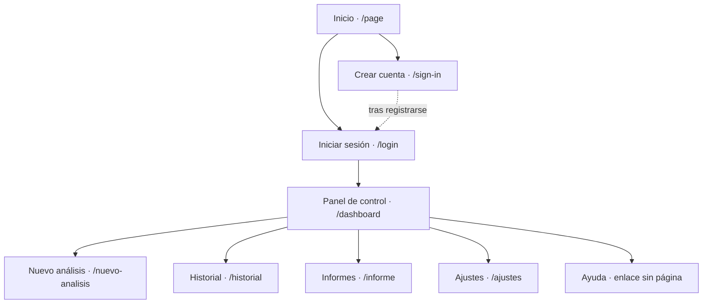

# LinkSight  Documentación del diseño en Figma

Enlace al Figma: https://www.figma.com/site/eQaznZsxAILc1rt8asjn07/LinkSight?node-id=0-1&t=jA7PDI9LyOqfoAIy-1

## Pasos que hemos seguido

1. Primero cogí los wireframes que ya teníamos y dejé las páginas en el mismo orden y con los mismos nombres (`/dashboard`, `/historial`...), como salen en la lista de páginas de Figma.
2. Luego elegí los colores y la letra (están explicados más abajo).
3. Hicimos una cabecera y un menú de la izquierda que son iguales en todas las pantallas de dentro de la web.
4. Al principio tenía barras blancas en los sitios donde iría el contenido. Las quitamos y puse textos y datos de ejemplo del proyecto: el bastión, Nuclei, las dependencias con OSV y NVD, las correcciones de la IA y los informes. Así el diseño se puede pasar a una página de verdad sin tener que inventar nada.
5. Hice el mapa de navegabilidad.
6. Al final añadí la página de perfil, a la que se entra pulsando el avatar de arriba a la derecha.

## Colores y estilo

- **Morado (#6B2FA8):** es el color principal y sale del logo. Lo uso en los botones importantes (Nuevo análisis, Iniciar análisis, Guardar cambios), en el menú cuando estás en esa página y en los títulos de las tablas. Es el color que hace que se reconozca LinkSight.
- **Azul oscuro:** también sale del logo. Lo uso para el avatar y para algunos números y detalles.
- **Lila muy claro:** es el fondo del menú de la izquierda y de la parte de atrás de la pantalla, para que las tarjetas blancas se vean bien encima.
- **Blanco:** las tarjetas y las tablas, para que se lea fácil.
- **Gris oscuro casi negro:** los textos y los títulos. El gris más claro lo uso para las explicaciones pequeñas debajo de los títulos.
- **Colores de severidad:** rojo para crítica, naranja para alta, amarillo para media y verde para baja. Los elegí así porque son como un semáforo y todo el mundo los entiende sin leer nada. Se usan igual en el Panel, el Historial y los Informes.
- **Colores de estado:** verde para «Completado», azul para «En curso» y rojo para «Fallido». Los enlaces de la última columna del historial (Ver informe, Ver progreso, Reintentar) van en azul oscuro.
- **Letra:** una sola letra sin adornos (Inter) en todas las pantallas. Los títulos van en negrita y más grandes, y el resto en normal. Es una letra fácil de leer en tablas con muchos datos.
- **Forma de las cosas:** tarjetas con las esquinas redondeadas y botones con las esquinas redondeadas, y siempre con espacio entre ellas para que no se vea agobiante.

## Explicaciones

- El mockup está debajo del wireframe para no perder el original y poder compararlos.
- Los colores son los del logo para que la web parezca parte del proyecto.
- Puse contenido de verdad en lugar de barras vacías porque así se ve si los textos y las tablas caben antes de programar.
- El menú de la izquierda es siempre el mismo para que se sepa dónde estás y se pueda ir a cualquier sitio desde cualquier pantalla.
- En «Nuevo análisis» hay una casilla para confirmar que tienes permiso para analizar esa web. La puse ahí, antes de empezar, porque en las amenazas del proyecto el mayor riesgo es que alguien lo use sin permiso.
- En el Panel se ve el estado del bastión porque lo especial del proyecto es que los análisis se hacen desde un servidor protegido en la DMZ.
- Los informes llevan la corrección que propone la IA, porque la idea es que no solo diga qué falla sino también cómo arreglarlo.

## Mapa de navegabilidad

Sirve para ver cómo se va de una página a otra. De Inicio se va al login o a crear cuenta, de ahí al Panel, y desde el Panel a todo lo demás.

- Inicio es la página que ve cualquiera. Desde ahí puedes iniciar sesión o crear una cuenta.
- Cuando te registras (la línea de puntos) vuelves al login para entrar.
- Al entrar llegas al Panel de control, que es la página principal de la web.
- Del Panel salen las demás por el menú de la izquierda: Nuevo análisis, Historial, Informes, Ajustes y Ayuda. Ese menú está en todas las pantallas de dentro, así que desde cualquiera puedes ir a cualquier otra.
- Ayuda por ahora es solo un enlace del menú y no tiene página.
- El perfil lo añadí al final. Se abre con el avatar de arriba a la derecha y el desplegable tiene Mi perfil, Ajustes, Panel de control y Cerrar sesión.

El camino más normal es: iniciar sesión, hacer un nuevo análisis, esperar a que termine, mirarlo en el historial y abrir el informe.

## Las pantallas

| Ruta | Qué sale |
| --- | --- |
| `/page` | Página de inicio con una explicación corta y los botones de entrar o registrarse |
| `/login` | Formulario para entrar |
| `/sign-in` | Formulario para crear cuenta |
| `/dashboard` | Resumen con análisis hechos, vulnerabilidades críticas, dependencias vulnerables, estado del servidor, hallazgos por severidad, tipos de vulnerabilidad, últimos análisis y estado del bastión |
| `/nuevo-analisis` | La URL de la web, el tipo de análisis (estático, dinámico o completo), los módulos a comprobar, el código fuente, la validación con IA, la casilla de permiso y un resumen de lo que se va a ejecutar |
| `/historial` | Tabla con ID, web, tipo, fecha, hallazgos, severidad máxima y estado, con buscador, filtros y botón de exportar CSV |
| `/informe` | Lista de informes y, al lado, el informe elegido con el resumen, los hallazgos principales y la corrección; se puede bajar en PDF y en Markdown |
| `/ajustes` | Perfil, conexión con el bastión, integraciones, formato de informe, seguridad de la cuenta y notificaciones |
| `/perfil` | Datos personales, verificación en dos pasos, contraseña, estadísticas y sesiones abiertas |

## Cómo está hecho en Figma

Cada pantalla la hice como un SVG a partir de una plantilla con la cabecera y el menú, y la pegué en Figma. Así los textos y las formas quedan como capas que se pueden editar, no como una foto. El perfil lo hice copiando el Panel y cambiando lo de dentro. El mapa del sitio lo guardé también como imagen aparte.

## Lo que se ha hecho después con el diseño

- La base de datos: miré qué datos salen en cada pantalla y de ahí saqué 14 tablas (usuarios, análisis, hallazgos, informes, auditoría...).
- La actividad A3 de arquitectura: la web va en una máquina virtual y lanza los análisis por SSH en el bastión.
