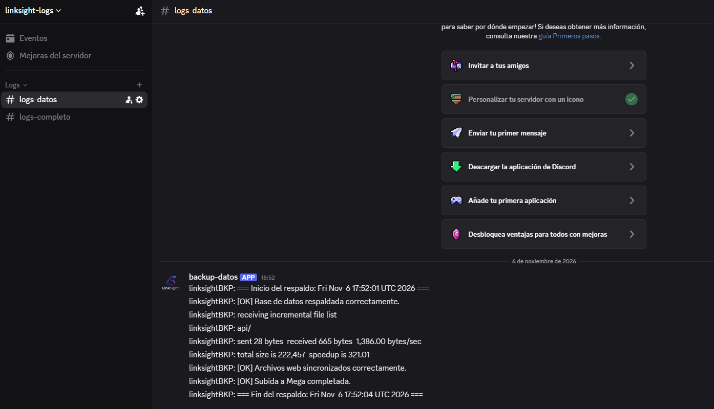

# Envío de logs de Proxmox a Discord

## 1. Objetivo

Recibir en Discord, en tiempo real, cada línea nueva que se añade a dos archivos de log generados por los scripts de backup. Cada archivo se envía a un canal distinto mediante su propio webhook.

## 2. Resumen de la solución

| Elemento | Decisión |
|---|---|
| Plataforma de mensajería | Discord (webhooks, sin necesidad de crear un bot) |
| Lectura del log | `tail -Fn0` (solo líneas nuevas, sigue el archivo si se rota) |
| Envío | `curl` + `jq` contra la API del webhook |
| Ejecución permanente | crontab con `flock` |
| Organización | 1 webhook + 1 script + 1 servicio por archivo de log |

## 3. Alternativas valoradas

- **Telegram (BotFather)**: requiere crear un bot, obtener el token y el `chat_id`. Se envía a `https://api.telegram.org/bot<TOKEN>/sendMessage`.
- **Slack**: Incoming Webhooks, igual que Discord con el JSON `{"text": "..."}`.
- **ntfy.sh / Gotify**: notificaciones push sin cuentas ni bots, también autoalojables.
- **Email**: con `msmtp` o `mailx`, más pesado de configurar.

Se eligió Discord por la sencillez de los webhooks y por permitir separar cada log en su propio canal.

## 4. Crear los webhooks en Discord

1. Crear un canal por cada log.
2. En cada canal: **Ajustes del canal → Integraciones → Webhooks → Nuevo webhook**.
3. Copiar la **URL del webhook** de cada uno.

> Los webhooks funcionan como contraseñas: quien tenga la URL puede publicar en el canal. No compartirlos ni subirlos a repositorios públicos.

## 5. Instalación de dependencias

```bash
apt update && apt install -y curl jq
```

## 6. Scripts

### Log 1

```bash
nano /usr/local/bin/logdiscord_1.sh
```

```bash
#!/bin/bash
WEBHOOK="https://discord.com/api/webhooks/ID_1/TOKEN_1"
LOGFILE="/var/log/backup_linksight.log"

tail -Fn0 "$LOGFILE" | while read -r line; do
  [ -z "$line" ] && continue
  curl -s -H "Content-Type: application/json" \
    -d "$(jq -n --arg c "$(hostname): ${line}" '{content: $c}')" \
    "$WEBHOOK" > /dev/null
  sleep 1
done
```

### Log 2

```bash
nano /usr/local/bin/logdiscord_2.sh
```

```bash
#!/bin/bash
WEBHOOK="https://discord.com/api/webhooks/ID_2/TOKEN_2"
LOGFILE="/var/log/otro.log"

tail -Fn0 "$LOGFILE" | while read -r line; do
  [ -z "$line" ] && continue
  curl -s -H "Content-Type: application/json" \
    -d "$(jq -n --arg c "$(hostname): ${line}" '{content: $c}')" \
    "$WEBHOOK" > /dev/null
  sleep 1
done
```

### Permisos

```bash
chmod 700 /usr/local/bin/logdiscord_1.sh /usr/local/bin/logdiscord_2.sh
```

### Explicación del script

- `tail -F`: sigue el archivo por nombre, aunque se rote o se recree.
- `-n0`: no muestra las líneas existentes; solo se envían las que se añaden a partir de que arranca el script. Para enviar también las últimas N líneas al arrancar, cambiar el `0` por ese número (por ejemplo, `-Fn10`).
- `[ -z "$line" ] && continue`: ignora líneas vacías.
- `jq -n --arg`: construye el JSON escapando correctamente comillas y caracteres especiales.
- `hostname`: antepone el nombre del servidor al mensaje.
- `sleep 1`: evita superar el límite de velocidad de la API.
- Límite de Discord: 2000 caracteres por mensaje.

## 7. Tarea crontab

### Al arrancar y relanzando si se cae

```cron
* * * * * flock -n /tmp/logdiscord_1.lock /usr/local/bin/logdiscord_1.sh >/dev/null 2>&1
* * * * * flock -n /tmp/logdiscord_2.lock /usr/local/bin/logdiscord_2.sh >/dev/null 2>&1
```

`flock -n` impide lanzar una segunda instancia si ya hay una en ejecución.

### Comprobar que está corriendo

```bash
pgrep -af logdiscord
```

## 8. Comprobación



Cada mensaje debe aparecer en su canal de Discord en aproximadamente un segundo.

## 10. Comandos de gestión

```bash
systemctl status logdiscord_1
systemctl restart logdiscord_1
systemctl stop logdiscord_1
journalctl -u logdiscord_1 -f
```

## 11. Notas y limitaciones

- Solo se envían las líneas añadidas después de arrancar el servicio.
- Si un log genera muchas líneas de golpe, los mensajes se irán enviando de uno en uno por el `sleep 1`.
- Discord limita los mensajes a 2000 caracteres; las líneas más largas fallarían.
